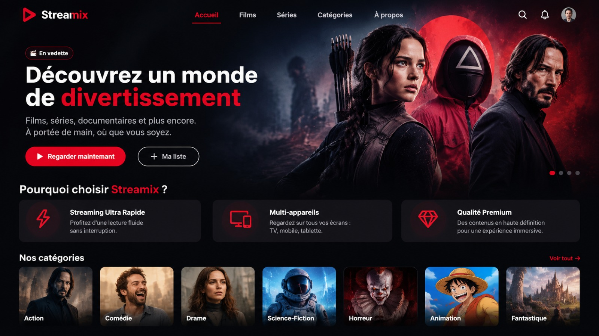

# Streamix – Plateforme de streaming de films

## 1. Sujet du projet

**Streamix** est une plateforme de streaming de films.

Elle permet aux utilisateurs de découvrir et de consulter des films. Les films sont organisés par genre cinématographique et par réalisateur.

## 2. Objectif du projet

L'objectif est de créer une plateforme simple pour gérer et consulter des films.

Le projet permet de :

- Afficher les films.
- Ajouter un film.
- Modifier un film.
- Supprimer un film.
- Gérer les réalisateurs.
- Gérer les genres cinématographiques.
- Classer les films par genre.

## 3. Technologies utilisées

| Partie | Technologie | Utilisation |
|---|---|---|
| Frontend | HTML | Structure des pages |
| Frontend | JavaScript | Actions de la page |
| Frontend | Tailwind CSS | Design de la page |
| Backend | PHP | Traitement des données |
| Communication | Fetch API | Échange des données |
| Stockage | JSON | Enregistrement des données |

## 4. Structure des données

Le projet utilise trois tables principales :

### Réalisateur

Cette table contient les informations des réalisateurs.

### Film

C'est la table principale du projet. Elle contient les informations des films.

### Genre cinématographique

Cette table permet de classer les films par genre.

## 5. Fonctionnalités principales

- **Gestion des films** : ajouter, afficher, modifier et supprimer.
- *Gestion des réalisateurs* : organiser les réalisateurs.
- ~~Gestion manuelle des films~~ : les données sont gérées par la plateforme.

## 6. Exemple de code

Exemple d'une requête avec Fetch API :

```javascript
fetch("http://localhost/backend/films.php")
    .then(response => response.json())
    .then(data => {
        console.log(data);
    })
    .catch(error => {
        console.log("Erreur :", error);
    });
```

## 7. Bloc de code

Exemple d'une réponse JSON :

```json
{
    "id": 1,
    "titre": "Inception",
    "realisateur": "Christopher Nolan",
    "genre": "Science-fiction"
}
```

## 8. Image du projet



## 9. Lien du projet

[Découvrir Streamix](https://github.com/MESBAHI-Nour/projet-technique/tree/session_3/prototype)

## 10. Liste des tâches

- [x] Définir le sujet du projet.
- [x] Choisir les technologies.
- [ ] Créer les pages HTML.
- [ ] Développer le backend PHP.
- [ ] Ajouter la communication avec Fetch API.
- [ ] Gérer les données JSON.
- [ ] Tester les fonctionnalités.

## 11. Étapes de réalisation

1. Créer la structure du projet.
2. Créer les interfaces avec HTML et Tailwind CSS.
3. Ajouter les actions avec JavaScript.
4. Développer les traitements avec PHP.
5. Enregistrer les données en JSON.
6. Tester la plateforme.

## 12. Citation

> Le cinéma est une fenêtre ouverte sur le monde.

---

## Conclusion

**Streamix** est un projet de plateforme de streaming de films.

Il utilise HTML, JavaScript, Tailwind CSS, PHP, Fetch API et JSON.

Son objectif est de proposer une plateforme simple pour organiser et consulter des films.