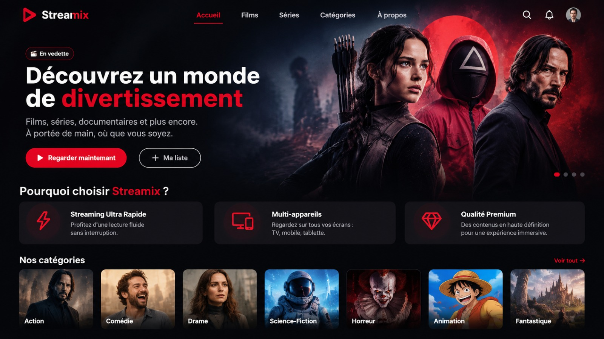
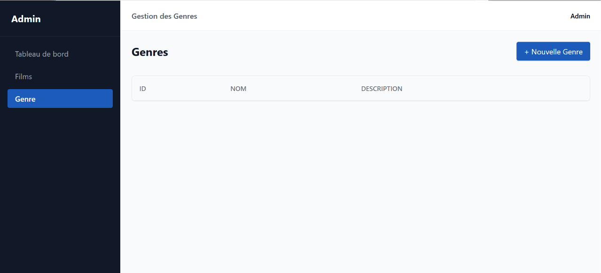

<!-- _class: cover -->
<!-- _paginate: false -->
<!-- _header: "" -->

<!-- Note présentateur : Bonjour. Je vous présente Streamix, notre projet technique de plateforme de streaming et de films. -->

 

# Streamix

### Présentation du Projet Technique — Plateforme de Streaming / Films

**Présenté par** : Mesbahi Nour &nbsp;&bull;&nbsp; **Encadré par** : ES-Sarraj Fouad

Établissement : **Centre SoliCode Tanger &bull; OFPPT**

---

<!-- header: "Streamix | Plan" -->

<!-- Note présentateur : Voici les cinq parties de notre présentation. -->

# Plan de la Présentation

1. **1. Introduction**
2. **2. Besoins du Projet**
3. **3. Analyse & Fonctionnalités**
4. **4. Conception & Données**
5. **5. Réalisation & Prototype**

---

<!-- header: "1. Introduction | Présentation du Projet" -->

<!-- Note présentateur : Cette partie présente Streamix et son objectif principal : organiser et consulter un catalogue de films. -->

# 1. Introduction

- **Streamix** : plateforme de streaming et de films
- **Catalogue de films** : consulter les films disponibles
- **Informations des films** : voir les détails de chaque film
- **Classement** : organiser les films par genre
- **Réalisateurs** : voir les réalisateurs associés aux films

---

<!-- header: "2. Besoins | Besoins du Projet" -->

<!-- Note présentateur : Cette diapositive présente les besoins principaux de la plateforme. -->

# 2. Besoins du Projet

### Besoins Fonctionnels :
- **Afficher les films** dans un catalogue
- **Consulter les informations** d'un film
- **Afficher les réalisateurs** des films
- **Classer les films** par genre cinématographique

### Besoins Non Fonctionnels :
- **Interface claire** : pages simples à utiliser
- **Navigation simple** : trouver facilement les films
- **Données organisées** : utiliser le format JSON
- **Communication** : échanger les données avec Fetch API

---

<!-- header: "3. Analyse | Les Éléments du Catalogue" -->

<!-- Note présentateur : Le catalogue repose sur trois éléments : les réalisateurs, les films et les genres. -->

# 3. Les Éléments du Catalogue

* **Réalisateur** :
  - Contient les informations sur le réalisateur
  - Peut être associé à des films

* **Film** :
  - Élément principal du projet
  - Contient les informations du film

* **Genre cinématographique** :
  - Classe les films par catégorie
  - Aide à organiser le catalogue

---

<!-- header: "3. Analyse | Fonctionnalités Clés" -->

<!-- Note présentateur : Voici les fonctions principales liées aux trois éléments du catalogue. -->

# 3. Fonctionnalités Clés

- **Films** :
  - Afficher le catalogue des films
  - Consulter les informations d'un film

- **Réalisateurs** :
  - Afficher les informations des réalisateurs
  - Voir les films associés

- **Genres cinématographiques** :
  - Afficher les genres
  - Classer les films par genre

---

<!-- header: "4. Conception | Architecture du Stockage JSON" -->

<!-- Note présentateur : Les données du projet sont enregistrées dans des fichiers JSON. Voici un exemple d'organisation possible. -->

# 4. Architecture du Stockage JSON

- **Organisation des fichiers** dans le dossier `/data` :
  - `data/realisateurs.json` : informations des réalisateurs
  - `data/films.json` : informations des films
  - `data/genres.json` : genres cinématographiques

- **Traitement avec PHP** :
  - **Lecture** : lire le fichier JSON
  - **Décodage** : transformer le JSON en données PHP
  - **Écriture** : enregistrer les données dans le fichier JSON

---

<!-- header: "4. Conception | Structure des 3 Tables" -->

<!-- Note présentateur : Cette diapositive présente les trois tables principales du projet et leur rôle. -->

# 4. Structure des Données (3 Tables)

- **Table Réalisateur** : informations des réalisateurs
- **Table Film** : table principale avec les informations des films
- **Table Genre cinématographique** : classification des films

> **Lien logique** : le **Film** est lié à un **Réalisateur** et à un **Genre cinématographique**.

---

<!-- header: "4. Conception | Exemples de Données" -->

<!-- Note présentateur : Voici un exemple simple pour montrer les liens entre les trois éléments. Les noms sont des exemples à remplacer par les données du projet. -->

# 4. Exemples de Données

| Film | Réalisateur | Genre cinématographique |
| :--- | :--- | :--- |
| Film 1 | Réalisateur 1 | Genre 1 |
| Film 2 | Réalisateur 2 | Genre 2 |

<small>Exemples de présentation. Les données réelles restent à ajouter.</small>

---

<!-- header: "5. Réalisation | Stack Technique" -->

<!-- Note présentateur : Voici les technologies utilisées pour créer Streamix. -->

# 5. Stack Technique Utilisée

- **HTML** : structure des pages
- **Tailwind CSS** : style et mise en page
- **JavaScript** : actions dans les pages
- **PHP** : traitement des données côté serveur
- **Fetch API** : communication entre JavaScript et PHP
- **JSON** : stockage des données

---

<!-- header: "5. Réalisation | Prototype : Page d'Accueil" -->

<!-- Note présentateur : Cette capture montre la page d'accueil de Streamix et la présentation du catalogue. -->

# 5. Prototype : Page d'Accueil



- **Nom Streamix** &bull; **Menu** &bull; **Catalogue des films** &bull; **Genres**

---

<!-- header: "5. Réalisation | Prototype : Fiche d'un Film" -->

<!-- Note présentateur : Cette capture montre une fiche avec les informations d'un film, son réalisateur et son genre. -->

# 5. Prototype : Fiche d'un Genre



- **Nom de Genre** &bull; **Description**

---

<!-- header: "5. Réalisation | Logique Serveur (PHP & JSON)" -->

<!-- Note présentateur : Cet exemple montre comment PHP lit les films depuis un fichier JSON. -->

# 5. Logique Serveur : PHP & JSON

```php
<?php
// 1. Chemin du fichier JSON
$jsonPath = __DIR__ . '/data/films.json';

// 2. Lecture des données
$json = file_get_contents($jsonPath);
$films = json_decode($json, true) ?? [];

// 3. Retour des données au frontend
header('Content-Type: application/json');
echo json_encode($films);
?>
```

---

<!-- header: "5. Réalisation | Interface & Communication" -->

<!-- Note présentateur : HTML et Tailwind CSS créent l'interface. Fetch API demande les données à PHP. -->

# 5. Interface & Communication

### Carte d'un film avec HTML et Tailwind CSS :

```html
<article class="rounded-xl border p-4 shadow-sm">
  <h2 class="text-xl font-bold">Titre du film</h2>
  <p class="text-gray-600">Réalisateur : Nom</p>
  <p class="text-gray-600">Genre : Nom</p>
</article>
```

### Demande des films avec Fetch API :

```javascript
fetch("backend/films.php")
  .then(response => response.json())
  .then(films => console.log(films))
  .catch(error => console.log(error));
```

---

<!-- _class: cover -->
<!-- _paginate: false -->
<!-- _header: "" -->

<!-- Note présentateur : Pour conclure, Streamix organise les films avec trois éléments principaux et utilise les technologies présentées dans ce projet. -->

# Conclusion & Perspectives

### Bilan du Projet :
- **Streamix** : plateforme de streaming et de films
- **Trois tables principales** : Réalisateur, Film et Genre
- **Stockage des données** avec JSON
- **Communication** avec Fetch API
- **Interface** avec HTML, JavaScript et Tailwind CSS

### Perspectives d'Évolution :
- **Recherche** de films par titre
- **Filtrage** des films par genre
- **Affichage** des détails d'un film
